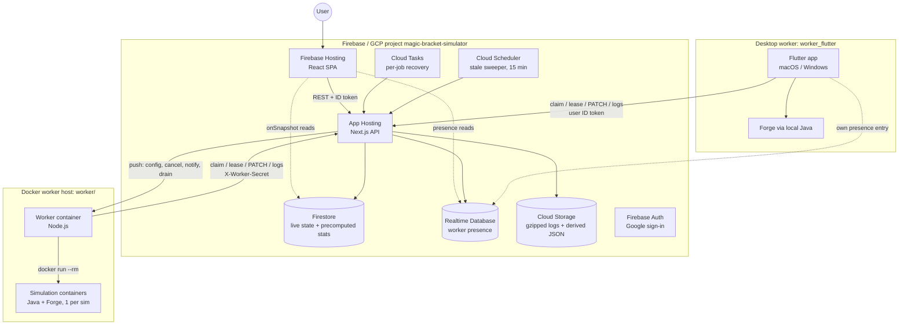

# Magic Bracket Simulator — Architecture Overview
Last Updated: 2026-10-30

How the pieces fit together today. `DATA_FLOW.md` (repo root) is the
detailed, step-by-step source of truth for dispatch, reporting and
aggregation; this page is the map.

---

## The pieces

| Piece | Where it runs | What it does |
|-------|---------------|--------------|
| **Frontend** (`frontend/`) | Firebase Hosting | Vite + React + Tailwind v4. Writes go through the API; live job, sim and pod-run state comes straight from Firestore `onSnapshot`, worker status from Realtime Database. |
| **API** (`api/`) | Firebase App Hosting (Cloud Run underneath), 1 instance, 1 GiB | Next.js 15 route handlers. Deck ingestion, job lifecycle, sim claiming and leases, log storage, aggregation, ratings, card stats, pod runs, access control. The only writer to Firestore and GCS. |
| **Desktop worker** (`worker_flutter/`) | User machines (macOS, Windows) | The path going forward. Cloud mode claims sims from the shared queue through the API with the signed-in user's token; offline mode runs bundled precons locally (drift SQLite). Ships through GitHub Releases + `appcast.xml` (Sparkle / WinSparkle) and installs Forge from `worker_flutter/forge-manifest.json`. |
| **Docker worker** (`worker/`) | Any Docker host | The original worker, still supported. Polls the API, runs one simulation container per sim with a semaphore sized from CPU/RAM, and exposes port 9090 for push control. Images on GHCR; Watchtower can auto-update it. |
| **Simulation image** (`simulation/`) | Spawned by the Docker worker | Java 17 + Forge + xvfb. Runs one sim (`GAMES_PER_CONTAINER` games), prints the log, exits. |
| **Shared types** (`shared/types/`) | Imported by api and frontend | Job, seat, simulation, pod-run, worker-presence and state-machine types. |

---

## Where data lives

**Firestore** holds live state and precomputed answers. Clients only read;
every write goes through the API with the Admin SDK (`firestore.rules`).

| Path | Contents |
|------|----------|
| `jobs/{jobId}` | One 4-deck pod: `seats` `[{deckId, name, link, colorIdentity}]`, status, sim counters, `results` `{gamesPlayed, seats: [{wins, avgWinTurn}]}` in seat order, `podRunId` |
| `jobs/{jobId}/simulations/{simId}` | One sim: state (PENDING / RUNNING / COMPLETED / FAILED / CANCELLED), `workerId`, `leaseExpiresAt`, winners |
| `podRuns/{runId}` | A saved run of several pods with its own `standings` |
| `decks/{deckId}` | Deck metadata and `.dck` content (precons and imports). A changed list is a new deck; there are no versions. |
| `decks/{deckId}/stats/rating`, `.../stats/cards` | TrueSkill and win counters, and per-card impact counters, built at aggregation |
| `workers/{workerId}` | Durable worker settings only: owner, push URL, concurrency override |
| `users/{uid}` | Access record, `status: requested \| allowed`. Not readable by clients. |
| `config/coverage`, `config/deckSelection`, `idempotencyKeys/*` | Auto-coverage settings, decks excluded from selection, job-creation idempotency |

**Realtime Database** holds `presence/{workerId}`: an entry per online
worker (`shared/types/worker-presence.ts`, rules in `database.rules.json`).
The desktop worker writes its own entry with an onDisconnect delete; the
Docker worker's heartbeat writes it through the API.

**Cloud Storage** (`magic-bracket-simulator-artifacts`) holds per-game
facts under `jobs/{jobId}/`: raw logs per sim (`raw/game_NNN.txt`, kept
forever) plus `condensed.json` and `structured.json`, all stored gzipped.

**Local mode** swaps these for SQLite (`api/data/jobs.db`) and the
filesystem (`logs-data/`). The SQLite schema has no migrations: after a
schema change, delete `jobs.db`.

---

## A job, end to end

1. **Create.** The frontend posts 4 deck ids to `POST /api/jobs` (or the
   coverage service picks a pod). The API writes the job with its `seats`,
   creates one PENDING sim doc per container, schedules a Cloud Tasks
   recovery check, and pushes `/notify` to reachable Docker workers.
2. **Claim.** Workers poll `GET /api/jobs/claim-sim?lease=1`. The API
   claims the oldest claimable sim in a transaction, promotes the job from
   QUEUED to RUNNING on its first claim, and returns the sim. The worker
   fetches decklists with `GET /api/jobs/:id` (worker view), which reads
   each seat's `.dck` by deck id.
3. **Run and hold the lease.** The worker runs Forge and extends the sim's
   3-minute lease about once a minute. The answer can tell it the job was
   cancelled or that another worker took the sim over.
4. **Report.** The worker uploads the raw log
   (`POST /api/jobs/:id/logs/simulation`) and then reports the result
   (`PATCH /api/jobs/:id/simulations/:simId`). An atomic counter on the job
   detects the last sim.
5. **Aggregate** (API, `aggregateJobResults`). Reads the raw logs, condenses
   and structures every game, writes `condensed.json` and
   `structured.json`, maps Forge winner names to seats, and sets the job
   COMPLETED with per-seat results. Then, fire-and-forget and idempotent per
   job: deck ratings, card stats, and the pod run's standings.
6. **Watch.** The frontend listens to the job and its sims in Firestore, so
   progress and results appear without polling (local mode polls the REST
   API instead).

**Crash recovery** uses the sim leases, not worker presence: a sim whose
lease has expired is claimable again. `recoverStaleJob` runs from the
per-job Cloud Tasks check and from the 15-minute stale sweeper
(`POST /api/admin/sweep-stale-jobs`), which also fails jobs stuck in the
queue and finishes jobs whose sims are all terminal.

---

## Access and auth

- Users sign in with Google (Firebase Auth). The API accepts a user when
  their `users/{uid}` record is `allowed` or their email is in
  `ADMIN_EMAILS` / `ALLOWED_EMAILS` (`api/lib/allowed-users.ts`,
  `api/lib/auth.ts`). New users request access in the app; an admin
  approves from the email link (`/api/access-requests/approve`).
- The Docker worker authenticates with `X-Worker-Secret`. The desktop
  worker sends the signed-in user's ID token and is accepted when that user
  is allowed (`isWorkerOrAllowlistedUser` in `api/lib/worker-auth.ts`).
- Local mode has no auth.

---

## Delivery

| Workflow | What it ships |
|----------|---------------|
| `ci.yml` | PR checks: lint, build, test (frontend, api, worker), release-script tests |
| `worker-flutter-ci.yml` | `flutter analyze` + `flutter test` for the desktop worker |
| `deploy.yml` | On merge: frontend to Firebase Hosting, Firestore rules + indexes, Realtime Database rules |
| App Hosting | Builds and rolls out the API from `main`; `rollout-safety-net.yml` forces a rollout if one doesn't appear |
| `deploy-worker.yml` | Worker and simulation images to GHCR |
| `release-worker.yml` | Desktop worker builds, GitHub Release, `appcast.xml` |
| `forge-update.yml` | Nightly Forge version bump PRs (auto-merge) |
| `sync-api-secrets.yml`, `provision-worker.yml` | Copy secrets from Doppler (source of truth) into GCP Secret Manager |

Errors go to Sentry (org `tytaniumdev`): projects `magic-bracket-api`,
`magic-bracket-worker` and `magic-bracket-frontend`.

---

## Key code references

| Concept | Location |
|---------|----------|
| Storage factories (SQLite vs Firestore) | `api/lib/*-store-factory.ts` |
| Sim claiming and leases | `api/app/api/jobs/claim-sim/`, `api/lib/sim-lease.ts` |
| Seats and per-seat results | `api/lib/job-seats.ts`, `api/lib/job-results.ts`, `shared/types/job.ts` |
| Aggregation | `api/lib/job-store-factory.ts` (`aggregateJobResults`), `api/lib/log-store.ts`, `api/lib/condenser/` |
| Ratings, card stats, pod standings | `api/lib/trueskill-service.ts`, `api/lib/card-impact/`, `api/lib/pod-run-standings.ts` |
| Recovery | `api/lib/stale-sweeper.ts`, `api/lib/cloud-tasks.ts`, `api/app/api/jobs/[id]/recover/` |
| Worker presence | `api/lib/worker-presence-store.ts`, `frontend/src/hooks/useWorkerStatus.ts`, `worker_flutter/lib/worker/worker_presence.dart` |
| Push to Docker workers | `api/lib/worker-push.ts`, `worker/src/worker-api.ts` |
| Docker worker loop | `worker/src/worker.ts` (`pollForSims`, `processSimulation`, `Semaphore`), `worker/src/docker-runner.ts` (`runSimulationContainer`, `calculateLocalCapacity`) |
| Desktop worker loop | `worker_flutter/lib/worker/worker_engine.dart`, `sim_api.dart`, `sim_lease_keeper.dart`, `log_uploader.dart` |
| Live job view | `frontend/src/hooks/useJobStream.ts`, `frontend/src/components/SimulationGrid.tsx` |
| Forge container entrypoint | `worker/forge-engine/run_sim.sh`, `simulation/Dockerfile` |
